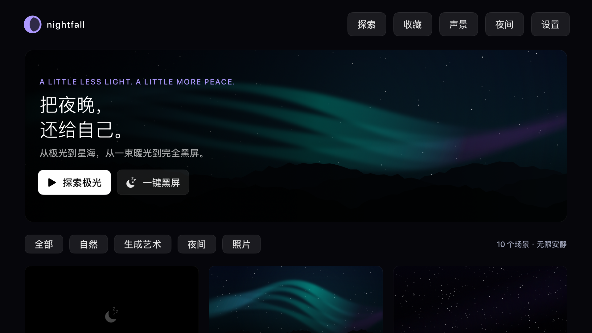
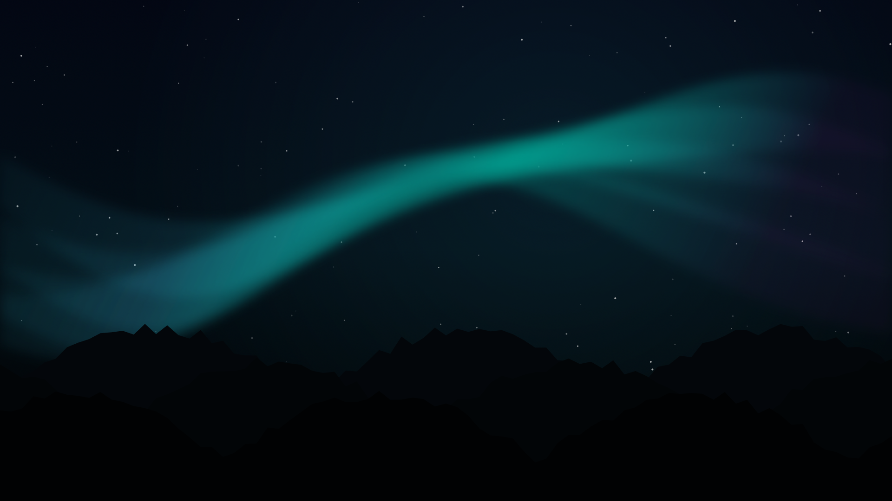
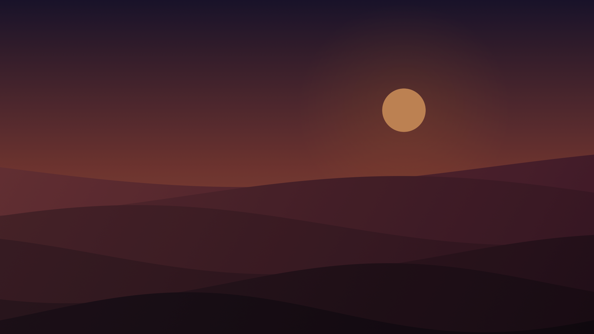
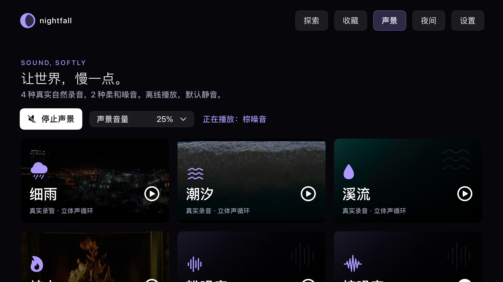
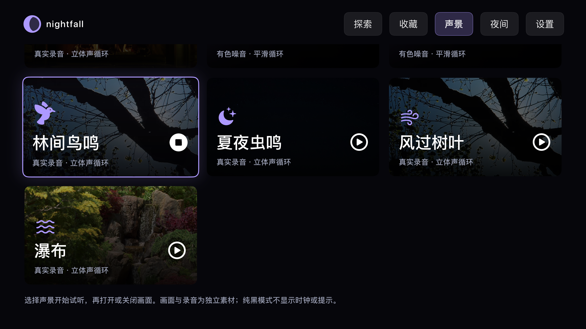
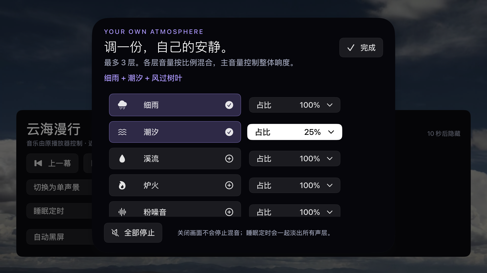
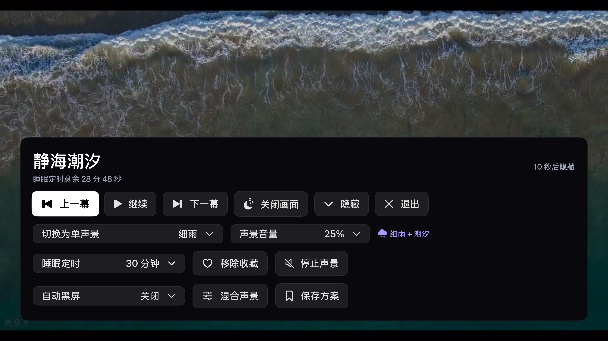

# Nightfall · 白噪音与助眠

An open-source Apple TV app for white noise, nature sounds, self-led meditation and bedtime listening. Mix up to three sounds, start a timed session, and listen with an optional nature background or a black screen. Built with SwiftUI and AVFoundation. Free, offline-first, no account, no ads.

原生 Apple TV 白噪音与助眠声音应用：15 种声音（11 种内置、4 种按需下载），含白噪音、粉噪音、棕噪音与真实自然录音。声景首页提供三层混音和 10/20 分钟自主静心；选择环境音即播放声音和实拍背景，控件显示十秒后隐藏，可关闭画面继续聆听。新增 5/10/20 分钟呼吸引导与可选系统语音节奏提示。全部功能与下载免费，无广告、无订阅。不提供语音课程、医疗诊断治疗或睡眠监测。



实拍视频、预览与自然录音的作者、来源及许可见[完整素材署名](MEDIA_LICENSES.md)。

| 实拍极光 | 实拍沙漠落日 |
|---|---|
|  |  |

## 功能

- **声音优先**：打开应用进入声景首页，主动选择声音或 10 分钟自主静心。静心页另有 20 分钟入口；以溪流录音陪伴休息，没有语音引导课程。
- **环境音与画面**：选择声音默认播放对应实拍背景；控件十秒后隐藏，确认键呼出。隐藏控件后保留声音名称，纯黑时隐藏全部提示。没有独立屏保、视频浏览、收藏轮播、照片画廊或漂移时钟。
- **呼吸冥想**：5/10/20 分钟练习，4 秒吸气配 6 秒或 4 秒呼气，圆环引导、剩余时长、暂停与继续、可选系统语音节奏提示；有效练习计时不消耗暂停时间。
- **真实景色**：10 个有免费再分发许可的摄影视频，仅随主动选择的环境音循环；预览为真实视频帧，最高 1080p，部分为 720p。
- **为卧室设计的全黑**：先选择声音，再主动关闭画面后输出 RGB 0/0/0，无提示、时钟或焦点边框；保留当前混音。未选声音时不能单独进入黑屏。不会在启动或闲置时自动进入。
- **柔和声景**：雨、海浪、溪流、炉火、林间鸟鸣、夏夜虫鸣、风过树叶、瀑布、粉噪音、棕噪音；另有白噪音；八种内置自然声为实录、三种噪音为频谱合成，立体声离线循环，主动选择后才发声。
- **聆听背景与画面开关**：声景页选声音后可搭配背景预览或关闭画面；播放中可换声景、调音量、关画面和恢复，保留睡眠计时。默认不自动发声。
- **三层声景混音**：最多同时搭配三种声音，调整每层相对音量；共有录音持续播放，不因增减声层而重新开始。主音量限制整体增益，睡眠淡出作用于全部声层。
- **个人睡前方案**：最多十二个命名方案，保存画面、纯黑状态、声层、音量、亮度和两种定时；在「静心 → 我的睡前方案」播放、纯黑听或移除，本地保存，重启后仍在。
- **先看风景，再关画面**：1／5／10／15／30 分钟后自动黑屏，最后十秒渐暗；声音和睡眠计时继续。音频暂停不延长定时，手动恢复取消本次画面计时。
- **睡前快捷方案**：30 分钟细雨、60 分钟棕噪音，一键纯黑入眠。
- **睡眠与静心**：5、10、15、20、30、60、90 或 120 分钟定时，结束后本应用呈黑色并恢复系统闲置；画面和本应用声音最后 30 秒一起淡出；自定义跨午夜规则。
- **显示偏好**：亮度、背景预览速度、减少动态效果、13 种主流语言与跟随系统；阿拉伯语支持从右到左布局。

| 声景画面开关 | 新增自然录音 |
|---|---|
|  |  |

| 三层声景混音 | 自动黑屏后恢复原画面 |
|---|---|
|  |  |

- **可选高清下载**：4 项原生 3840×2160 实拍、4 项 48 kHz／24-bit／立体声 ALAC 自然录音。下载前显示容量与署名，支持进度、取消、播放和删除；校验 SHA-256 后才登记。约 200 MB 素材托管于 [独立内容 Release](https://github.com/ZanwingMak/NightfallTV/releases/tag/content-2026-10)，不打入应用包。tvOS 可能清理缓存，可免费重下。
- **赞助支持**：StoreKit 2 消耗型打赏，美国基准价格 $0.99／$2.99／$4.99／$9.99，实际以 Apple 当地价格为准。全部功能与下载免费，没有订阅或功能解锁。
- **官网与法律文件**：[官方网站](https://zanwingmak.github.io/NightfallTV/)、[隐私政策](https://zanwingmak.github.io/NightfallTV/privacy.html)、[服务条款](https://zanwingmak.github.io/NightfallTV/terms.html)和帮助页，可在应用设置扫码访问。

| 可选 4K 下载 | 应用内开发支持 |
|---|---|
|  |  |

## 使用

启动 Nightfall → 选择声景或混音 → 选择「关闭画面 · 继续听」，或开始 10/20 分钟自主静心。播放开始显示控制，十秒后隐藏；纯音频时确认键显示控制、返回键先隐藏控制再退出。退出或停止声音即结束会话。无本应用媒体播放时遵循 tvOS 的闲置设置；不保证只播放外部音乐时能无限维持静音黑屏。

当前修复构建为 **1.4.0（14）**，针对 2.5.8 拒审移除了独立景色播放功能。商店是否可用以 Apple 审核结果为准。[公开 TestFlight 邀请](https://testflight.apple.com/join/FS1H6N5w)保留；外部可安装构建取决于 Apple Beta 审核。真机听感、背光和长时间播放由用户验收。

[Apple 当前 TestFlight 安装指南](https://beta.itunes.apple.com/)要求 Apple TV 运行 tvOS 18 或以上（应用自身最低 tvOS 17）。邮件邀请需在手机或电脑打开取得兑换码，再到电视上的 TestFlight → Redeem 输入代码；详细安装和配对步骤见[回归文档](docs/回归测试.md#testflight-真机验收)。

| 遥控器 | 操作 |
|---|---|
| 确认 / Select | 播放时显示控制层 |
| 返回 / Back | 先隐藏控制层，再返回播放前的页面 |
| 方向键 | 移动播放控件焦点，黑屏隐藏控制时不会误亮 |
| 播放 / 暂停 | 暂停 / 继续本应用声音及背景预览，睡眠定时继续 |
| Home / Siri | 由系统处理 |

## 构建与回归

需要 macOS、Xcode（包含 tvOS SDK）、Apple TV 模拟器；最低 tvOS 17。仓库包含生成好的 Xcode 工程，没有第三方应用依赖。

```bash
open NightfallTV.xcodeproj
xcodebuild -project NightfallTV.xcodeproj -scheme NightfallTV \
  -destination 'generic/platform=tvOS Simulator' CODE_SIGNING_ALLOWED=NO build
```

在 Xcode 中选择任意 Apple TV 模拟器，按 `⌘U` 执行测试。命令行测试可将设备 ID 替换为本机 `xcrun simctl list devices available` 的结果：

```bash
xcodebuild -project NightfallTV.xcodeproj -scheme NightfallTV \
  -destination 'platform=tvOS Simulator,id=YOUR_SIMULATOR_ID' \
  CODE_SIGNING_ALLOWED=YES CODE_SIGN_IDENTITY=- DEVELOPMENT_TEAM= test
```

1.4.0（10）在本地与[独立云端回归](https://github.com/ZanwingMak/NightfallTV/actions/runs/38837932194)均完成连续 51/51 测试，0 失败、0 跳过，覆盖全部 13 种语言、15 种声音的资源与遥控器操作。以下为历史回归记录：1.3.0（7）已在 Apple TV4K 模拟器完成 **32 个单元测试＋19 个遥控器 UI 测试的联合验收，51 项均有通过记录，0 未解决失败、0 跳过**（2026-10-13）。[云端完整运行](https://github.com/ZanwingMak/NightfallTV/actions/runs/38275774332)为 50 通过、1 个下载瞬态按钮时序失败；修正测试后，[云端下载专项](https://github.com/ZanwingMak/NightfallTV/actions/runs/38287433450)及本地同一专项均 5/5 通过。这是分次联合覆盖，不是一次连续 51/51 记录。测试包括十三语言遥控导航、纯黑逐像素检查、画面定时、三层混音与方案、视频循环、真实 4K／无损资源下载播放删除，以及四档 StoreKit 模拟交易状态。测试详情与实际截图见[回归记录](docs/回归测试.md)。真机听感与长时间播放由用户验收。其中照片网络专项访问本仓库的公开截图，离线执行可追加 `-skip-testing:NightfallTVTests/PersistenceTests/testRemotePhotosAndCache`。

如需修改工程配置，安装 XcodeGen 后执行 `xcodegen generate`。实拍视频可用 `python3 scripts/import_media.py` 重新导入（需 FFmpeg，遵守来源网站限流）。自然录音可用 `python3 scripts/import_audio.py` 重新导入，有色噪音可用 `python3 scripts/generate_audio.py` 生成（两者需要 FFmpeg，以及 `python3 -m pip install -r scripts/requirements-audio.txt` 安装的 NumPy）；图标用 `swift scripts/generate_assets.swift` 生成。安装到自己的真机或发布时，请在 Xcode Signing 中替换为自己的 Team 和 Bundle ID；`ExportOptions.plist` 是本项目维护者的发布配置示例，其他开发者需替换对应值。

## 平台边界

这是需手动启动的独立应用，不能成为 tvOS 的系统屏保插件，不能在其他应用上盖黑屏，也不能控制电视背光、关电视或停止外部音乐。LCD 即使输出全黑仍可能有背光；系统音量、Siri 等覆盖层不受应用控制。自然风景仅配合音频会话播放，不提供独立静音景色播放。黑屏聆听不会改变电视硬件背光。

## 文档与开源

- [需求与目标](docs/需求与目标.md)
- [回归计划与实测记录](docs/回归测试.md)
- [隐私说明](PRIVACY.md)
- [问题与建议](https://github.com/ZanwingMak/NightfallTV/issues)

代码、原创图标和有色噪音使用 MIT。实拍视频、原帧预览与自然录音保留原许可，详见[素材来源与许可](MEDIA_LICENSES.md)及应用「设置 → 视听素材来源与授权」。
