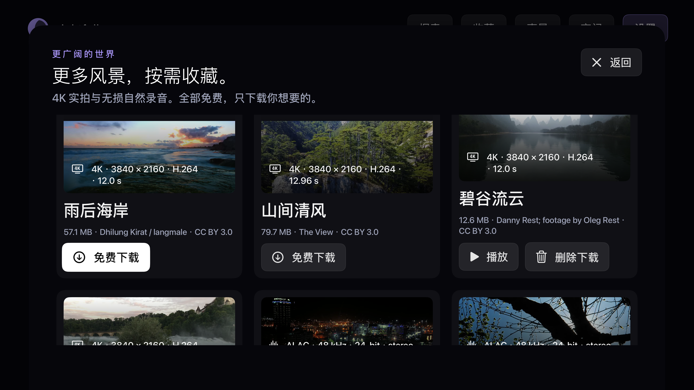
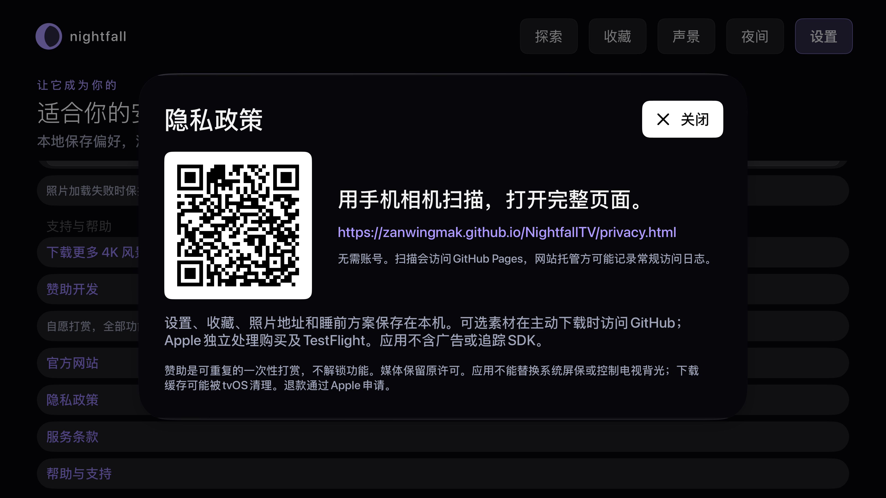
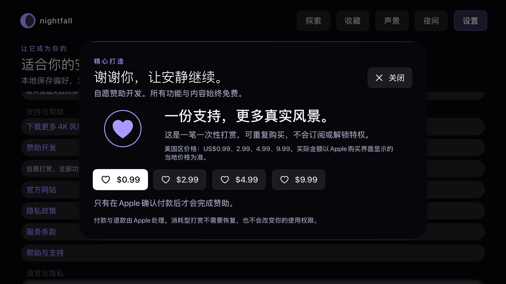
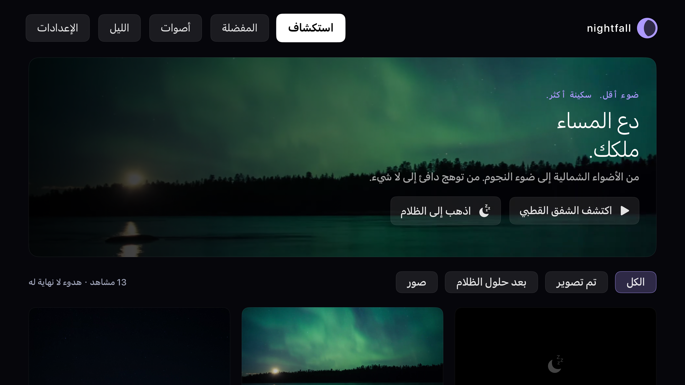

# 回归测试

## 自动化

- 配置默认值、损坏数据恢复、亮度/音量/时间参数边界。
- 夜间规则：当天、跨午夜、起止边界、同小时全天。
- 睡眠计时：取消、重设、到期、后台时间经过、渐弱系数。
- 轮播：空列表、单项、顺序、随机不重复、暂停时间。
- 图片地址：HTTPS、非 HTTPS、凭证、缺主机、重复、数量上限。
- tvOS UI：首屏、10 场景启动、纯黑、控制显示/隐藏、返回、收藏、设置、启动黑屏。
- 全黑截图逐像素检测，验证 RGB 全零。

## 模拟器交互与视觉

在 Apple TV 模拟器检查首页、屏保库、收藏、声景、夜间与设置；截图检查遮挡、截断和焦点。4K、长时间动态播放和不同音频输出纳入下述真机验收。

## TestFlight 真机验收

安装准备（[Apple 官方 TestFlight 指南](https://beta.itunes.apple.com/)）：应用自身最低 tvOS 17；Apple 当前列出的 TestFlight 设备要求为 tvOS 18 或以上。在 Apple TV 安装 TestFlight，在手机或电脑打开邀请邮件中的「View in TestFlight」取得兑换码，然后在电视上的 TestFlight 选择 Redeem 并输入兑换码，安装 **1.0.2（4）**。仅接受邀请还不代表已安装。

如需由这台 Mac 操作真机回归，先让 Mac 与 Apple TV 位于同一网络，在电视打开「设置 → 遥控器与设备 → 遥控 App 与设备」，在 Xcode 的 Devices and Simulators 选择发现的 Apple TV 并输入电视上的配对码；较新 Xcode 使用 Device Hub。参考 [Apple 设备配对说明](https://help.apple.com/xcode/mac/current/en.lproj/devbc48d1bad.html)和 [Device Hub 指南](https://developer.apple.com/documentation/xcode/pairing-your-devices-with-your-mac)。

1. Apple TV 安装 TestFlight，接受内部测试邀请或输入兑换码。
2. 依次播放所有内置场景，连续运行至少 30 分钟。
3. 在 Apple Music 播放歌曲，返回桌面再启动 Nightfall TV，进入纯黑；记录是否持续播放及音量是否变化。
4. 重复 AirPlay 音频、蓝牙/HomePod 输出；另测会停止后台播放的第三方播放器。
5. 验证遥控器确认、返回、方向和播放暂停；系统 Home/Siri 仍归系统处理。
6. 定时到期不亮屏、环境音逐渐停止；外部音乐继续播放且不被本应用控制。
7. OLED / LCD 分别观察全黑效果；LCD 背光不能由 app 关闭。
8. 记录设备、tvOS 版本、构建号和结果。只有实际执行才标为通过。

## 执行结果

2026-10-12，Xcode 26.5、tvOS 26.5，Apple TV 4K（第三代）1080p 模拟器，1.0.0（构建 2）：

| 项目 | 结果 |
|---|---|
| 完整自动化 | 12 个单元测试 + 5 个 UI 测试，17/17 通过、0 失败 |
| 照片网络专项补测 | 13 个单元测试全部通过，新增真实 HTTPS 图片下载、解码、缓存复用、非图片响应拒绝验证；与 UI 合计 18 项 |
| 首页标题修正后专项回归 | 黑屏与遥控器完整流程再次通过；两行标题完整可见 |
| 纯黑像素 | 正常进入、隐藏控制、启动即黑屏（开启时钟偏好）均为 RGB 全零 |
| 10 种场景 | 全部可启动；9 种非黑场景保存真实渲染截图 |
| 声景 | 6 个 WAV 均能解码；遥控器播放雨声与停止操作通过 |
| 设置 | 夜间页面与设置值可见；遥控器选择亮度 20% 通过 |
| 收藏 | 详情收藏操作和收藏列表启动通过 |
| Release | tvOS 真机目标归档、发行证书签名及 App Store IPA 导出通过 |
| GitHub | [公共仓库](https://github.com/ZanwingMak/NightfallTV)已发布；[云端完整回归](https://github.com/ZanwingMak/NightfallTV/actions/runs/38166099652) **18/18 通过、0 失败**（Xcode 16.4、tvOS 26.1 模拟器） |
| TestFlight | 1.0.0（2）校验、上传及 Apple 处理通过；Nightfall Internal 含 1 名内部测试员，构建状态「正在测试」；已填写测试重点；测试员状态「已接受」，暂无设备、使用次数或已安装构建记录 |
| Apple TV 真机安装与音乐兼容 | **待测**：当前 Mac 尚无已配对的 Apple TV |

本地保留 `artifacts/Regression-final.xcresult`、`artifacts/Hero-final.xcresult` 和 `artifacts/Photos-final.xcresult`；结果包包含 UI 截图。公开截图位于 [screens](screens)。网络专项需要访问本仓库公开截图，断网时可跳过 `PersistenceTests/testRemotePhotosAndCache`。测试结果不等同于真实电视的音频、背光和 30 分钟稳定性验收。

最终发布标签 `v1.0.0` 对应提交 `a3a5934` 的[再次完整回归](https://github.com/ZanwingMak/NightfallTV/actions/runs/38166569816)也已通过。尚未完成的真机项目继续保持待测。

随后一次云端运行暴露 UI 测试同步问题：遥控器返回后立即检查控制按钮不存在，偶尔读到尚未更新的界面快照。已将该断言改为等待按钮消失（最多 5 秒），仍逐像素检查恢复后的纯黑；未跳过断言或自动重试失败。修正后回归执行中。CI 对仅文档修改不重复启动应用测试。

## 实拍场景与 4K 模拟器专项（1.0.1 构建 3）

按用户要求移除程序绘制自然场景，替换为七个免费授权的真实摄影片段。全部资源随应用内置，视频去掉声音轨，素材完整署名见 [素材许可](../MEDIA_LICENSES.md)。原 1.0.0 的截图和测试记录不能当作本次实拍版通过的证据。

独立设备为 Nightfall TV UI Audit 4K，Apple TV 4K 第三代、tvOS 26.5；截图输出 3840×2160，素材自身最高 1080p、部分 720p。新增实际视频解码、无声音轨、持续运动、暂停像素一致、恢复运动、遥控器左右切换、方向键不误亮纯黑、超过片段时长后的循环运动测试。

已实测并修正两项交互问题：选择睡眠定时时控制层十秒超时导致选项框消失；详情返回后分类回到全部。修正后选择期间保持控制层，关闭选项框后重新计时；分类由根界面保存。选项框返回测试等待呈现和关闭动画结束，避免动画中快速连按返回被系统忽略。自动隐藏以最终画面 RGB 全零验证。

本机磁盘不足曾导致一份专项结果包写入失败，该次不作为通过依据；已清理本任务重复构建与诊断缓存并重新执行。保留失败摘要、日志和截图。完整实拍回归最终 **23/23 通过，0 失败、0 跳过**：14 个单元测试、9 个 UI 测试。结果包 `artifacts/RealFootage-final.xcresult`，摘要 `artifacts/real-footage-summary.json`。实际截图已替换到 `docs/screens`。

最终截图人工检查：首页双行标题、导航与分类选中态、卡片、黑屏控制层、夜间页面、中英文设置、定时选择及素材署名页没有关键文字遮挡。焦点采用白底黑字或紫色边框，未聚焦的当前页面/分类保留紫色选中标识。真实电视可读性、音乐兼容和长时间稳定性仍待真机验收。

手动通过 Simulator 方向键操作补充发现：原生卡片焦点把正文变成白底，白色标题对比度不足。已用统一自定义卡片样式修正，保留深色正文、紫色焦点边框和轻微放大；实拍库与声景卡片共用此样式。实际聚焦截图见 `screens/cards-focused.png`；修正后再执行遥控器专项和云端完整回归。

云端 tvOS 26.1 回归补充发现选项框生命周期差异：呈现 sheet 时底层 ChoicePicker 会收到 onDisappear，错误清除了选择状态，导致十秒自动隐藏。已移除该错误清理路径，改由选项框关闭、会话结束及后台切换清理；继续在两个系统版本回归，不通过前不上传最终构建。

根据 [Apple 音频会话说明](https://developer.apple.com/library/archive/documentation/Audio/Conceptual/AudioSessionProgrammingGuide/ConfiguringanAudioSession/ConfiguringanAudioSession.html)，AVFoundation 播放对象可能自动激活会话。实拍播放器除移除音轨和静音外，在创建时预设 ambient（允许混音），不主动 setActive；纯黑路径不创建视频播放器。媒体专项增加实际 ambient 会话类别与播放器静音断言，真机外部音乐仍需实测。

混音测试校正：tvOS 26.5 模拟器的 ambient 类别不会在读取 categoryOptions 时显式返回 mixWithOthers 位。此前位标志断言失败，已改为验证实际 ambient 类别、播放器静音及资源无音轨；依据 [Apple 对 ambient 隐式混音的说明](https://developer.apple.com/documentation/avfaudio/avaudiosession/categoryoptions-swift.struct/mixwithothers)，不尝试给 ambient 设置仅适用于其他类别的显式选项。该自动化结果仍不代表真机 Apple Music 已测。

播放退出会恢复进入屏保前的页面：从精选或卡片详情开始，会回到详情继续收藏或返回；从一键黑屏或收藏轮播开始，会回到对应浏览页。确认键只显示控制，返回键先隐藏控制再退出播放。

## 1.0.1（3）最终交付记录

- 最终源代码提交 `bf7a50f` 的 [GitHub 完整回归](https://github.com/ZanwingMak/NightfallTV/actions/runs/38172124599) **23/23 通过、0 失败、0 跳过**（14 单元 + 9 UI；Xcode 16.4、tvOS 26.1）。
- 本地 tvOS 26.5 的完整实拍回归 23/23 通过；后续卡片焦点专项 3/3、选项框生命周期专项 1/1、最终媒体/混音专项 1/1 通过。音频配置变更后的实际视频暂停/恢复及启动纯黑两项 UI 也通过。保留对应 xcresult 与摘要，失败试次没有算作通过。
- 最终 IPA 版本 1.0.1、构建 3，七个真实拍摄视频及署名完整打包；发行签名、导出、Apple 校验与上传成功。SHA-256：`6ac075e6726413bb72fad8cd0553c2ba19e40ca97e7d6dfbedb7aef4640a3c6c`。
- Apple 官方 API 确认构建为 `VALID`，内部状态 `IN_BETA_TESTING`，已加入 Nightfall Internal；新版测试说明已保存。重新登录后网页确认 1.0.1（3）状态为「正在测试」，测试员状态为「已安装」，设备为 Apple TV 4K（第三代）、tvOS 26.6。核验记录见 [release-status.json](release-status.json)。
- 真机安装已有 App Store Connect 记录；Apple Music/AirPlay/HomePod/蓝牙音频、遥控器、OLED/LCD 黑屏观察和三十分钟真机播放验收仍待实际结果。当前 Mac 没有已配对的 Apple TV；安装和分发状态不能替代这些行为验收。

聚焦实拍卡片和声景卡片的手动截图分别为 [cards-focused](screens/cards-focused.png)、[sounds-focused](screens/sounds-focused.png)。最终 GitHub 标签包含同一份已测试应用源码及补充的交付记录，不改变二进制功能。

## 1.0.2（4）用户问题回归

用户指出首排中间／右侧卡片无法直接向上进入分类，且自然声景内容与名称不符。旧 UI 测试的目标搜索可以绕行，不证明单次向上操作可用；旧音频解码测试也不证明素材听起来像对应自然声音。

- 新增真实遥控器单次向上测试，旧代码从极光、星空卡片向上失败；为分类、精选操作区和声景控制条补充横向焦点区域后通过。测试依次覆盖首排三列 → 分类 → 精选 → 顶部导航。
- 移除六个旧 12 秒单声道 WAV。雨、海浪、溪流和炉火改为带完整来源许可的立体声实录，循环为 37、90、47.5、90 秒；粉噪音和棕噪音改为 60 秒立体声周期频谱合成。溪流与噪音卡片使用明确的符号背景，避免极光等无关景色误导。
- 音频经 30 Hz 高通（实录）、直流移除、三秒接缝交叉淡化（实录）、匹配 RMS 和柔和峰值限制；以 ALAC 保存。部分来源本身为 MP3/Vorbis，不称原始无损录音。实测 RMS 为 −25.15～−25.45 dBFS，采样峰值最高 −11.27 dBFS；粉／棕噪音频谱斜率为 −3.00／−5.99 dB 每倍频程。
- 新增音频规格、响度、削波余量与循环边界检查，以及六项声景切换、停止、首排向上和携带声景进入纯黑的 UI 回归。声音种类由原录音及作者说明核对；数值检查不替代用户听感确认。已提供取自打包素材的四项试听。

最终执行结果：本地完整回归 **26/26 通过，0 失败、0 跳过**（15 单元 + 11 UI），结果包 `artifacts/Regression-4.xcresult`。最终停止图标和辅助功能标签调整后，两项声景 UI 专项 **2/2 通过**，结果包 `artifacts/Sounds-final-4.xcresult`。最终源码 `588a821` 的 [GitHub 完整回归](https://github.com/ZanwingMak/NightfallTV/actions/runs/38192272274)也 **26/26 通过**（Xcode 16.4、tvOS 26.1）。

手动模拟器复核同一星空卡片位置，单次向上进入分类按钮，真实截图见 [操作前](screens/up-before.png)与[操作后](screens/up-after.png)。声景预览、标签与停止图标也已人工查看。

Release 归档、发行签名、导出、Apple 校验、上传和处理通过。IPA SHA-256 为 `daa713c07d4147902c4f5b59c6604ac64039b83583905cebde945b7f75e145ce`；包内含7个静音视频、6个新 ALAC 音频、0个旧 WAV，六项音频与仓库逐字节一致。TestFlight **1.0.2（4）** 为 `VALID`、`IN_BETA_TESTING`，Nightfall Internal 已包含该构建；测试重点和应用说明均保存并复核。

后续 TestFlight 网页已记录修复版1.0.2（4）安装到 Apple TV 4K（第三代，tvOS 26.6）。官方反馈 API 当前没有截图或崩溃反馈提交；空反馈不能证明无问题。当前 Mac 仍未配对 Apple TV，真实电视的听感、外部音乐兼容与30分钟播放结果保持待确认。没有把自动化通过、安装或分发状态当作这些验收的证据。

## 1.1.0（5）有声屏保、画面开关与内容扩充

新增庭园瀑布、飘雪、云海实拍，现有13种屏保、10个实拍视频。新增鸟鸣、夏夜虫鸣、树叶风声和瀑布真实录音，现有10种离线声景（8项实录、2项有色噪音）。来源、单项 SHA-256、原始格式和许可保存在素材清单与 [MEDIA_LICENSES.md](../MEDIA_LICENSES.md)。所有视频去掉音轨，图像与声音使用独立素材，不声称同期录音或原生4K。

声景页可以自选画面或关闭画面继续听；播放器可换声音、调音量、关闭和恢复画面。单元回归验证画面切换不改变所选声音、播放列表、暂停状态和睡眠截止时间，并检查 AVAudioPlayer 实际仍在播放。直接纯黑启动可按所选声景恢复推荐画面。夜间规则和定时结束后禁止打开画面。新增细雨30分钟、棕噪音60分钟纯黑快捷方案，睡眠最后30秒画面与本应用声音同步淡出。

扩充网格暴露末排仅一张卡片时的焦点死角：从上一排右列向下无法到达末排左列。将每行设为完整横向焦点区域后，以真实遥控器单次向下分别验证飘雪→云海、风声→瀑布，保留首排三列单次向上回归。没有以目标搜索绕行代替这些单次方向断言。

前几次本地运行因磁盘不足出现截图、模拟器启动和结果写入失败，结果未计为通过；一次播放退出后的返回操作过早，测试增加等待详情页呈现后再按返回。已清理本任务的可再生下载、旧构建和重复测试附件，旧结果保留摘要与发布记录；最终完整结果包仍保留。

最终应用源码提交 `fbfd065203a9099f19e9e2e6612ba9d11674927b`：

| 验证 | 实际结果 |
|---|---|
| 本地完整回归 | Xcode26.5、tvOS26.5、Apple TV4K第三代模拟器，18单元＋14UI，**32/32通过，0失败、0跳过** |
| 新功能专项 | 有声启动／睡前方案、自配画面／纯黑恢复／换声音、10项声景／首排向上、末排单次向下，**4/4通过** |
| GitHub独立完整回归 | Xcode16.4、tvOS26.1，**32/32通过，0失败、0跳过**；[运行记录](https://github.com/ZanwingMak/NightfallTV/actions/runs/38204028253) |
| 音频 | 全部10项实际解码，立体声、44.1kHz ALAC；响度、直流、峰值余量与循环边界检查通过 |
| 打包一致性 | 10个静音实拍视频、10个ALAC音频，与仓库清单逐项SHA-256一致，没有旧WAV |
| 发行 | Release归档、发行签名、IPA导出、Apple校验与上传通过 |

IPA SHA-256：`683aff5bfb51451d89fe53d55bf1ad88595ab6825ff20f85410acb86b8eb98c1`。最终本地结果包 `artifacts/Regression-verified-5.xcresult`，摘要 `artifacts/regression-summary-5.json`；专项 `artifacts/Expansion-verified-5.xcresult`。旧版本部分结果包为节省磁盘转为同名 `.summary.json`，公开截图仍保留。

人工通过 Simulator 方向键复核新增声景卡片、自选海浪画面搭配鸟鸣、关闭为纯黑及恢复原海浪。实际截图见 [声景控制](screens/sound-controls.png)、[新增声景](screens/new-soundscapes.png)、[有画面控制](screens/sound-picture.png)、[纯黑声景控制](screens/sound-black-controls.png)、[睡前方案](screens/bedtime-routine.png)。自动化附件为3840×2160；人工控制层截图包含模拟器窗口。没有把录音来源核对、音频指标或画面中的播放标识当作主观听感验收。

1.1.0（5）的真机安装、音质、外部音乐兼容、物理黑屏和30分钟播放仍待实际结果。当前 Mac 无已配对 Apple TV，旧1.0.2（4）的安装记录不当作新版安装证据。TestFlight处理及分发状态以 [release-status.json](release-status.json) 的最终查询为准。

后续完工核验：Apple官方构建使用指标当前返回1.1.0（5）安装0、会话0、邀请3、反馈0、崩溃0；指标可能延迟，不能据此声称真机安装或行为验收完成。截图反馈与崩溃反馈接口也未返回提交。当前Mac仍没有配对Apple TV。已有API密钥更新应用总说明返回403，网页仍在登录页；未扩大权限或更换密钥。[官方构建指标接口](https://developer.apple.com/documentation/appstoreconnectapi/get-v1-builds-_id_-metrics-betabuildusages)。

## 最终验收交接

用户明确要求「真机验收交给我来，你在模拟器验收完即可」。因此开发侧验收以模拟器为准，真实电视的听感、外部音乐、背光及30分钟播放由用户负责；交接不等同于这些项目已通过。最终应用源码与完成32项回归的 `fbfd065` 一致，没有为更新交付记录再次改变应用或重复测试。

重新登录后已在App Store Connect保存1.1.0新版应用总说明，并通过官方API逐字核对持久化内容。1.1.0（5）仍为VALID／IN_BETA_TESTING，已加入Nightfall Internal且构建测试重点已保存。GitHub v1.1.0已公开发布；开发、资源许可、模拟器UI／遥控器验收、签名上传及内部测试分发均完成。真机后续反馈作为用户验收结果处理。

## 1.2.0（6）混音、个人方案与独立自动黑屏

根据同类产品的官方公开功能，加入三层声景混音、最多十二个命名睡前方案和独立画面计时。本轮沿用现有许可素材，没有把竞品宣传或音频播放标识当作实测证据。

回归发现并修正混音面板顶部完成按钮的焦点死角，以及嵌套音量选择关闭后不应清除父面板的选择状态。首次完整回归39/40通过，方案删除确认失败；弹窗改为捕获呈现时的方案对象，避免关闭弹窗先清空待删除对象，测试等待实际列表移除。删除修正专项1/1通过后重新完整测试，失败运行不计入通过。

最终应用源码 `2a40f45c434e47f1c1f13727c85790559e368c16` 的本地完整回归：Xcode26.5、tvOS26.5、Apple TV4K第三代模拟器，24个单元测试＋16个遥控器UI测试，**40/40通过、0失败、0跳过**。结果包 `artifacts/Regression-final-6.xcresult`、摘要 `artifacts/regression-summary-6.json`；删除专项 `artifacts/Routine-fixed-6.xcresult`。旧偏好迁移、方案保存／重启恢复／删除、真实AVAudioPlayer持续播放位置、三层限制、增益余量及已有素材解码检查均通过。

自动黑屏UI用例真实等待一分钟，并在画面暂停时逐像素验证全黑；恢复后保留雨声与潮汐、保留三十分钟睡眠定时，并取消本次画面计时。单元测试分别验证画面最后十秒淡暗与睡眠最后三十秒声音淡出，夜间全天黑屏规则不能被方案恢复绕过。

实际截图已人工检查混音面板和四行播放控制，聚焦按钮、声音名称、音量及两种定时没有关键文字遮挡。截图见 [混音](screens/sound-mixer.png)、[画面恢复与计时](screens/picture-timer.png)。中英文设置、声景入口与夜间页截图也已检查。Mac锁屏使额外的窗口手动按键复核暂时无法执行；方案列表的保存、重启恢复及删除遥控器流程已经由UI测试实际通过。真机验收沿用用户交接约定，不作为开发交付阻塞项，也不声称真实电视已经通过。

发行候选重新签名归档、导出及Apple校验已通过；第一次校验传输发生分块校验不一致，保留失败日志，重新提交同一完整安装包后校验成功，未上传旧的删除修正前安装包。最终IPA SHA-256为 `1b5ef238bf49ba18621fa016b848ebdec9d8a41d654b353bfd79c7d448b6aa0d`，包内20项媒体资源与仓库清单逐项一致。

最终源码的[GitHub完整回归](https://github.com/ZanwingMak/NightfallTV/actions/runs/38255699835)也已**40/40通过、0失败、0跳过**，24单元＋16UI。旧源码云端运行与本地一样在方案删除断言失败，未算作通过；最终运行使用同一个删除修正提交，未跳过失败用例。

Apple官方API确认1.2.0（6）为VALID／IN_BETA_TESTING，已加入Nightfall Internal。构建测试重点、应用总说明和包含个人方案的隐私说明均保存并逐字复核；真机验收继续交接用户。

GitHub [v1.2.0](https://github.com/ZanwingMak/NightfallTV/releases/tag/v1.2.0)已公开发布，标签应用源码与40项通过的最终源码一致。TestFlight网页显示1.2.0（6）正在测试；测试员页面记录新版已安装到Apple TV4K第三代／tvOS26.6，仅作为安装证据，不代表声音和音乐兼容等真机验收通过。

## 1.3.0（7）模拟器回归

2026-10-12，Apple TV 4K（第三代）模拟器、tvOS 26.5。应用源码 `d0d643ddbac2e089381c64bbe0f935089b99c29f`。

- 首轮完整 51 项：48 通过、3 失败、0 跳过。两个旧断言尚未适配可选媒体和新安装跟随系统语言，现已修正；下载 UI 用例遭遇 TLS 连接中断，显示失败与重试入口。
- 修正后重跑全部 32 项单元测试和真实媒体下载 UI 用例，33/33 通过。与首轮通过的其余 18 项 UI 合计覆盖全部 51 项，0 未解决失败、0 跳过；这不是一次不中断的 51/51 执行记录。
- 十三种语言逐一启动，使用真实遥控器方向键进入设置、语言选择并返回；阿拉伯语镜像布局已截图复核。卡片首排向上、最后单卡行、播放器和混音方案保留原完整回归。
- 四档本地 StoreKit 模拟商品价格、已验证交易、重复消费型购买、加载失败、用户取消、购买失败与待批准后完成均已验证。本地模拟交易不产生真实收费，不能据此声称 App Store 商品审核通过。
- 真实访问已发布的 GitHub 素材：校验 SHA-256、4K 视频与 48 kHz 立体声录音解码；遥控器执行下载、取消、播放和删除。新增 JPEG 海报已修复并检查实际界面。
- 纯黑逐像素检查、独立画面定时真实等待、三层混音、方案持久化、视频循环及官网／隐私／条款／帮助二维码均通过。
- Release 真机目标签名归档和导出成功：1.3.0（7）、13 种语言，`get-task-allow=false`，无 StoreKit 测试配置文件、无额外高清媒体文件。Apple 上传前包校验成功。TestFlight 处理状态和云端完整回归以随后实际记录为准。

| 可选下载库 | 应用内隐私链接 |
|---|---|
|  |  |

| 开发支持（本地模拟商品） | 阿拉伯语镜像布局 |
|---|---|
|  |  |

真机听感、其他音乐应用兼容、背光与长时间播放由用户验收。

### 构建 7 发布状态

Apple 校验和上传成功；构建 ID `77bd07e9-3598-481c-9ebe-928c5a634baa`，处理状态 `VALID`、内部状态 `IN_BETA_TESTING`，已加入原 Nightfall Internal 组，中英文构建测试说明已保存。签名 IPA 为 186,458,310 字节，SHA-256：`d14fb0db310963c2f57d3727ff8172aed721f3a338b670618ad282ec4761b7ba`。

赞助商品的本地模拟测试已通过；App Store Connect 四个消耗型商品已创建，0.99 美元档已设置价格及十三语感谢支持描述。四档十三语感谢支持描述已通过官方版本化接口全部保存并读取核验；另外三档价格、销售范围及四档审核截图尚需恢复网页登录后完成，价格和审核截图 API 写入被拒绝；不得将此状态当作正式内购已审核或已开放销售。隐私／营销／支持 URL 的后台字段也需恢复网页登录后保存，应用内二维码和官网页面已可用。
